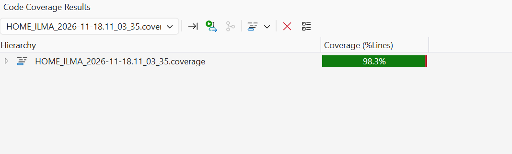

# Izvještaj – Task 2: Unit testiranje

**Predmet:** Verifikacija i validacija softvera, projektni zadatak – I dio
**Tim:** Grupa 5 – Tim 3 (Hana, Amna, Amina, Dževad, Ilma)
**Aplikacija:** GoSarajevo (vlastiti OOAD projekat, projekat `gosarajevovol3`, .NET 8)
**Testni projekat:** `gosarajevovol3.Tests` (MSTest 3.6.4, Moq 4.20.72, EF Core InMemory 8.0.10)

## 1. Struktura testnog projekta

| Folder | Sadržaj |
|---|---|
| `Hana/`, `Amna/`, `Amina/`, `Dzevad/`, `Ilma/` | Testne klase svakog člana, jedna klasa po kontroleru ili servisu |
| `Helpers/` | Zajednički pomoćni kod: `TestHelper` (baza u memoriji, lažni prijavljeni korisnik, mock objekti za `UserManager`, `SignInManager`, `IServiceScopeFactory`), `FakeHttpMessageHandler`, `CsvDataSourceAttribute`, `XmlTestData` |
| `Podaci/` | CSV i XML fajlovi za data-driven testove |

Pravila koja poštuju svi testovi:

- Ime testa je `Metoda_Scenarij_OčekivaniRezultat` (notacija Roya Osherovea sa Predavanja 6).
- Tijelo testa ima tri dijela: priprema, poziv, provjera (AAA). U testnim metodama nema `if` ni petlji.
- Svaki test pravi svoju bazu u memoriji (`[TestInitialize]`) i briše je (`[TestCleanup]`), pa testovi ne zavise jedan od drugog ni od redoslijeda.
- Testovi ne koriste internet, pravu bazu ni slanje e-maila.

### Podjela koda

Na aplikaciji su u okviru OOAD-a radile Hana, Amna i Amina. Dževad i Ilma nisu pisali ovaj kod, pa su preuzeli dijelove od autorica sa najviše koda, tako da svi imaju približno isti obim (534–594 linije).

| Član | Testirani kod | Testnih klasa | Testnih metoda | Izvršavanja (sa redovima podataka) |
|---|---|---:|---:|---:|
| Hana | `SmartPlannerController`, view modeli planera, `SmartPlanner`, `Preference` | 2 | 43 | 87 |
| Amna | `ThingsToDoController`, `VisitController`, `InformationController`, `ReviewController`, `AdminController`, modeli `Hospitality`, `Attraction`, `Coordinates`, `Review` | 4 | 72 | 104 |
| Amina | `KupiKartuScraper`, `KupiKartuService`, `GeocodingService`, `ApplicationDbContext` | 4 | 54 | 77 |
| Dževad | `AccountController`, `UserProfileController`, `UserService`, view modeli naloga, klase korisnika | 4 | 67 | 95 |
| Ilma | `NPSScraper`, `NPSService`, `EventsController`, `HomeController`, `OperatorController`, modeli `Event`, `Newsletter` | 5 | 65 | 103 |
| **Ukupno** | | | **301** | **466** |

## 2. Izmjene aplikacije radi testabilnosti

Dio koda se u izvornom obliku nije mogao testirati bez interneta i slanja pravih e-mailova. Urađene su male izmjene koje ne mijenjaju ponašanje aplikacije (isti princip kao primjer `GetTimeOfDay` sa Predavanja 5):

| Izmjena | Razlog |
|---|---|
| Novi interfejs `IEmailService` i klasa `SendGridEmailService`; `AccountController` i `OperatorController` ga primaju kroz konstruktor | Kontroleri su sami pravili `SendGridClient`, pa bi test slao pravi e-mail. Sada se u testu koristi mock |
| `GeocodingService`, `KupiKartuScraper` i `NPSScraper` imaju dodatni konstruktor koji prima `HttpClient` | Klase su same pravile `new HttpClient()`. Test im daje klijenta sa lažnim odgovorima |
| Novi interfejs `IEventTranslator` i klasa `GoogleEventTranslator`; kod prevoda je prenesen iz `NPSService` i `KupiKartuService` | Prevod poziva Google servis. Ujedno je uklonjen duplirani kod |
| `NPSService` i `KupiKartuService` imaju interni konstruktor i svojstvo `NextRunDelay` | Test zadaje scraper, prevodilac i kratko čekanje, da ne čeka do ponoći |
| Tri pomoćne metode u `SmartPlannerController` su `internal` umjesto `private`; u `.csproj` je dodan `InternalsVisibleTo` | Direktno testiranje računanja udaljenosti i broja lokacija |
| `Program.cs`: registrovan `IEmailService` | Da aplikacija dobije stvarnu implementaciju |

`SendGridEmailService` i `GoogleEventTranslator` su označeni atributom `[ExcludeFromCodeCoverage]`, jer samo prosljeđuju poziv vanjskom servisu i ne mogu se izvršiti bez mreže.

## 3. Data-driven testiranje

Korištene su sve tri vrste sa Predavanja 6:

| Vrsta | Atribut | Gdje su podaci |
|---|---|---|
| Inline | `[DataRow]` | U samom kodu testa |
| Member | `[DynamicData]` | XML fajlovi u folderu `Podaci/`, čita ih `XmlTestData.Read` |
| Izvor podataka | `[CsvDataSource]` | CSV fajlovi u folderu `Podaci/` |

Napomena o trećoj vrsti: klasični atribut `[DataSource]` sa `TestContext.DataRow` radi samo na .NET Frameworku, a aplikacija je .NET 8. Zato je napravljen vlastiti atribut `CsvDataSourceAttribute`, koji implementira MSTest interfejs `ITestDataSource` (isti koji interno koriste `DataRow` i `DynamicData`). Ponaša se kao `DataSource`: test se izvršava jednom za svaki red CSV fajla.

Pohranjeni podaci su u dva formata, CSV i XML:

| Član | Fajl | Šta sadrži | Test koji ga koristi |
|---|---|---|---|
| Hana | `hana_hospitality_slots.csv` | ocjene interesa korisnika i očekivani broj ugostiteljskih mjesta dnevno | `SmartPlannerControllerTests.CalculateHospitalitySlots_OcjeneIzCsvFajla_VracaOcekivaniBrojMjesta` |
| Hana | `hana_haversine.xml` | parovi koordinata i očekivana udaljenost u metrima | `SmartPlannerControllerTests.Haversine_KoordinateIzXmlFajla_VracaUdaljenostUMetrima` |
| Hana | `hana_broj_dana.csv` | datumi dolaska i odlaska, očekivani broj dana i ispravnost datuma | `SmartPlannerModelsTests.SmartPlannerInputViewModel_DatumiIzCsvFajla_RacunaBrojDanaIIspravnostDatuma` |
| Amna | `amna_validacija_objekata.xml` | slučajevi dodavanja novog objekta i ishod validacije | `HospitalityModelsTests.Hospitality_PodaciIzXmlFajla_ValidacijaDajeOcekivaniRezultat` |
| Amna | `amna_tipovi_objekata.csv` | tip ugostiteljskog objekta i očekivani broj objekata | `ThingsToDoAndVisitControllerTests.Hospitality_TipIzCsvFajla_VracaSamoObjekteTogTipa` |
| Amna | `amna_tipovi_atrakcija.csv` | tip atrakcije iz URL-a i očekivani broj atrakcija | `ThingsToDoAndVisitControllerTests.VisitIndex_TipIzCsvFajla_VracaOcekivaniBrojAtrakcija` |
| Amina | `amina_kategorije.csv` | adresa kategorije i očekivani tip događaja | `KupiKartuScraperTests.ChooseCategory_AdresaIzCsvFajla_VracaOcekivaniTip` |
| Amina | `amina_dogadjaji.xml` | sačuvani HTML stranica događaja i podaci koje scraper treba izvući | `KupiKartuScraperTests.ScrapeEvents_StranicaIzXmlFajla_IzvlaciPodatkeODogadjaju` |
| Dževad | `dzevad_preusmjeravanje.csv` | e-mail korisnika i stranica na koju se preusmjerava prema ulozi | `AccountControllerTests.LoginPost_UspjesnaPrijava_PreusmjeravaPremaVrstiKorisnika` |
| Dževad | `dzevad_preusmjeravanje.csv` | e-mail korisnika i stranica na koju se preusmjerava prema ulozi | `AccountControllerTests.ProfileRoute_PrijavljenKorisnik_PreusmjeravaPremaVrstiKorisnika` |
| Dževad | `dzevad_registracija.xml` | slučajevi registracije novog korisnika i ishod validacije | `AccountModelsTests.RegisterViewModel_PodaciIzXmlFajla_ValidacijaDajeOcekivaniRezultat` |
| Ilma | `ilma_trajanje.csv` | tekst sa stranice i očekivano trajanje predstave | `NPSScraperTests.ScrapePlayDetails_TekstIzCsvFajla_KrajJePocetakPlusTrajanje` |
| Ilma | `ilma_predstave.xml` | sačuvani HTML stranica predstava i podaci koje scraper treba izvući | `NPSScraperTests.ScrapePlayDetails_StranicaIzXmlFajla_IzvlaciNazivSlikuIOpis` |
| Ilma | `ilma_newsletter.csv` | naslov i sadržaj newslettera i da li se prihvata | `OperatorControllerTests.SendNewsletter_NaslovISadrzajIzCsvFajla_PrihvataSamoPopunjeneVrijednosti` |

Broj data-driven testova po članu:

| Član | Metoda sa `[DataRow]` | Metoda sa `[DynamicData]` (XML) | Metoda sa `[CsvDataSource]` (CSV) |
|---|---:|---:|---:|
| Hana | 7 | 1 | 2 |
| Amna | 8 | 1 | 2 |
| Amina | 6 | 1 | 1 |
| Dževad | 7 | 1 | 2 |
| Ilma | 7 | 1 | 2 |

## 4. Zamjenski objekti

Zamjenski objekti su pravljeni bibliotekom Moq (`Mock<T>`, `Setup`, `Verify`), kao na Predavanju 6. Baza podataka je zamijenjena EF Core bazom u memoriji, a internet klasom `FakeHttpMessageHandler`.

| Član | Šta je zamijenjeno | Funkcionalnost koja se testira | Primjer testa |
|---|---|---|---|
| Hana | `IConfiguration` (ključ za Google mape) | Prikaz forme i rezultata planera bez prave konfiguracije | `Index_RegistrovanKorisnik_CitaKljucMapeIzKonfiguracije` |
| Amna | `UserManager<User>` | Samo administrator smije pristupiti akcijama `AdminController` | `OnActionExecutionAsync_KorisnikJeObicanKorisnik_PristupJeZabranjen` |
| Amina | `IEventTranslator`, `IServiceScopeFactory`, internet (`FakeHttpMessageHandler`) | Pozadinski servis upisuje pročitane događaje i svaki prevodi tačno jednom | `ExecuteAsync_NoviDogadjaj_PozivaPrevodilacTacnoJednom` |
| Dževad | `IUserService`, `UserManager<User>`, `SignInManager<User>`, `IEmailService`, `IUrlHelper` | Prijava, registracija i slanje linka za reset lozinke bez pravog e-maila | `ForgotPasswordPost_NalogPostoji_SaljeEmailSaLinkomZaReset` |
| Ilma | `IEmailService`, `UserManager<User>`, `IEventTranslator` | Newsletter se šalje jednom porukom na adrese svih pretplatnika | `SendNewsletter_DvaPretplatnika_SaljeJednuPorukuNaObjeAdrese` |

Testovi označeni kategorijom `Mock` (u Test Exploreru: grupisanje po *Traits*):

- **Hana** (1): `SmartPlannerControllerTests.Index_RegistrovanKorisnik_CitaKljucMapeIzKonfiguracije`
- **Amna** (4): `AdminControllerTests.OnActionExecutionAsync_KorisnikJeAdministrator_AkcijaSeIzvrsava`, `AdminControllerTests.OnActionExecutionAsync_KorisnikJeObicanKorisnik_PristupJeZabranjen`, `AdminControllerTests.OnActionExecutionAsync_KorisnikJeOperator_PristupJeZabranjen`, `AdminControllerTests.OnActionExecutionAsync_KorisnikNijePronadjen_PristupJeZabranjen`
- **Amina** (3): `KupiKartuServiceTests.ExecuteAsync_NoviDogadjaj_PozivaPrevodilacTacnoJednom`, `KupiKartuServiceTests.ExecuteAsync_PrevodilacPostaviEngleskiNaziv_NazivSeCuvaUBazi`, `KupiKartuServiceTests.ExecuteAsync_DogadjajNijeUSarajevu_NeUpisujeGaINePrevodi`
- **Dževad** (14): `AccountControllerTests.LoginPost_ValidniPodaci_ProsljedjujeEmailILozinkuServisu`, `AccountControllerTests.Logout_PrijavljenKorisnik_OdjavljujeIPreusmjeravaNaPrijavu`, `AccountControllerTests.SwitchAccount_PrijavljenKorisnik_OdjavljujeIPreusmjeravaNaPrijavu`, `AccountControllerTests.ForgotPasswordPost_NalogPostoji_SaljeEmailSaLinkomZaReset` i drugi
- **Ilma** (11): `NPSServiceTests.ExecuteAsync_DvijeNovePredstave_PrevodilacSePozivaZaSvaku`, `NPSServiceTests.ExecuteAsync_PrevodilacPostaviEngleskiNaziv_NazivSeCuvaUBazi`, `NPSServiceTests.ExecuteAsync_StranicaPredstaveNedostupna_PredstavaSePreskace`, `OperatorControllerTests.OnActionExecutionAsync_KorisnikJeOperator_AkcijaSeIzvrsava` i drugi

Po jedan test sa zamjenskim objektom za svakog člana (kod testa i rezultat u Test Exploreru):

**Hana** – `Index_RegistrovanKorisnik_CitaKljucMapeIzKonfiguracije`

**Amna** – `OnActionExecutionAsync_KorisnikJeObicanKorisnik_PristupJeZabranjen`

**Amina** – `ExecuteAsync_NoviDogadjaj_PozivaPrevodilacTacnoJednom`

**Dževad** – `ForgotPasswordPost_NalogPostoji_SaljeEmailSaLinkomZaReset`

**Ilma** – `SendNewsletter_DvaPretplatnika_SaljeJednuPorukuNaObjeAdrese`

## 5. Korišteni atributi (stereotipi)

| Atribut | Gdje je korišten |
|---|---|
| `[TestClass]`, `[TestMethod]` | Sve testne klase |
| `[TestInitialize]`, `[TestCleanup]` | Priprema i brisanje baze u memoriji prije i poslije svakog testa |
| `[ClassInitialize]`, `[ClassCleanup]` | `ApplicationDbContextTests`: baza se pravi jednom jer je testovi samo čitaju |
| `[DataRow]`, `[DynamicData]`, `[CsvDataSource]` | Data-driven testovi (poglavlje 3) |
| `[ExpectedException]` | Testovi izuzetaka, npr. `LoginPost_ModelJeNull_BacaNullReferenceException` |
| `[Timeout]` | Pozadinski servisi i generisanje plana za 30 dana |
| `[TestCategory]` | Svi testovi: naziv cjeline, te `DataDriven` i `Mock` |
| `[Priority]` | Najvažniji test svake cjeline ima prioritet 1 |
| `[Ignore]`, `[TestProperty]` | `GeocodingServiceTests`: integracijski test koji traži internet se preskače |

Korištene su klase `Assert`, `CollectionAssert` i `StringAssert`.

## 6. Pokrivenost koda

Alat: ugrađena pokrivenost koda u Visual Studiju 2026 (**Test → Analyze Code Coverage for All Tests**). Fine Code Coverage je instaliran, ali se u Visual Studiju 2026 (verzija 18.11) ne učitava (`Failed Initialization`). Od verzije 2026 ista funkcija postoji ugrađena i u izdanju Community, pa je korištena ona. `Program.cs`, pogledi (`Views`) i migracije su isključeni u fajlu `gosarajevovol3.Tests/coverage.runsettings`.

**Ukupna pokrivenost linija koda: 98,3 %** (Visual Studio), što je iznad traženih 90 %.

Za pregled po klasama korišten je i alat coverlet, koji Fine Code Coverage koristi u pozadini. On daje 99,4 %. Razlika od oko jednog procentnog poena dolazi od toga što dva alata ne broje iste dijelove koda; na primjer, Visual Studio broji i kod koji kompajler generiše za `async` metode i lambda izraze.

| Klasa | Testirao | Pokrivene linije | Pokrivenost linija | Pokrivene grane |
|---|---|---:|---:|---:|
| `Controllers.AccountController` | Dževad | 175/175 | 100.0 % | 48/50 |
| `Controllers.AdminController` | Amna | 129/129 | 100.0 % | 42/42 |
| `Controllers.EventsController` | Ilma | 24/24 | 100.0 % | 2/2 |
| `Controllers.HomeController` | Ilma | 22/22 | 100.0 % | 6/6 |
| `Controllers.InformationController` | Amna | 8/8 | 100.0 % | 4/4 |
| `Controllers.OperatorController` | Ilma | 51/51 | 100.0 % | 12/12 |
| `Controllers.ReviewController` | Amna | 84/84 | 100.0 % | 45/48 |
| `Controllers.SmartPlannerController` | Hana | 209/215 | 97.2 % | 112/128 |
| `Controllers.ThingsToDoController` | Amna | 46/46 | 100.0 % | 16/16 |
| `Controllers.UserProfileController` | Dževad | 29/29 | 100.0 % | 6/8 |
| `Controllers.VisitController` | Amna | 21/21 | 100.0 % | 8/8 |
| `Data.ApplicationDbContext` | Amina | 87/87 | 100.0 % | 0/0 |
| `Models.Attraction` | Amna | 8/8 | 100.0 % | 0/0 |
| `Models.Coordinates` | Amna | 3/3 | 100.0 % | 0/0 |
| `Models.ErrorViewModel` | Ilma | 2/2 | 100.0 % | 0/0 |
| `Models.Event` | Ilma | 14/14 | 100.0 % | 0/0 |
| `Models.Hospitality` | Amna | 10/10 | 100.0 % | 0/0 |
| `Models.Newsletter` | Ilma | 7/7 | 100.0 % | 0/0 |
| `Models.Operator` | Dževad | 1/1 | 100.0 % | 0/0 |
| `Models.Preference` | Hana | 8/8 | 100.0 % | 0/0 |
| `Models.RegisteredUser` | Dževad | 3/3 | 100.0 % | 0/0 |
| `Models.Review` | Amna | 8/8 | 100.0 % | 0/0 |
| `Models.SmartPlanner` | Hana | 10/10 | 100.0 % | 0/0 |
| `Services.Abstract.EmailSendResult` | Ilma | 1/1 | 100.0 % | 0/0 |
| `Services.Concrete.UserService` | Dževad | 52/52 | 100.0 % | 4/4 |
| `Services.GeocodingService` | Amina | 27/27 | 100.0 % | 2/2 |
| `Services.Scrapers.KupiKartuScraper` | Amina | 217/220 | 98.6 % | 66/66 |
| `Services.Scrapers.KupiKartuService` | Amina | 73/74 | 98.6 % | 24/28 |
| `Services.Scrapers.NPSScraper` | Ilma | 157/157 | 100.0 % | 70/72 |
| `Services.Scrapers.NPSService` | Ilma | 59/59 | 100.0 % | 16/16 |
| `ViewModels.ForgotPasswordViewModel` | Dževad | 1/1 | 100.0 % | 0/0 |
| `ViewModels.LogInViewModel` | Dževad | 3/3 | 100.0 % | 0/0 |
| `ViewModels.PlannerLocationViewModel` | Hana | 7/7 | 100.0 % | 0/0 |
| `ViewModels.ProfileViewModel` | Dževad | 3/3 | 100.0 % | 0/0 |
| `ViewModels.RegisterViewModel` | Dževad | 3/3 | 100.0 % | 0/0 |
| `ViewModels.ResetPasswordViewModel` | Dževad | 4/4 | 100.0 % | 0/0 |
| `ViewModels.ReviewFormViewModel` | Amna | 5/5 | 100.0 % | 0/0 |
| `ViewModels.SmartPlannerInputViewModel` | Hana | 22/22 | 100.0 % | 0/0 |
| `ViewModels.SmartPlannerResultViewModel` | Hana | 7/7 | 100.0 % | 0/0 |
| **Ukupno** | | **1600/1610** | **99.4 %** | **483/512 (94.3 %)** |

Sve klase su iznad traženih 90 %. Linije koje nisu pokrivene:

- `SmartPlannerController` (6 linija): zaštitne grane koje se sa važećim ulazom ne mogu dostići (negativan broj slotova, dan koji je već pun prije ubacivanja događaja).
- `KupiKartuScraper` (3 linije): prazan `catch` blok oko dijeljenja teksta datuma; kod u `try` bloku ne može baciti izuzetak.
- `KupiKartuService` (1 linija): kraj metode `ExecuteAsync` iza beskonačne petlje; servis se zaustavlja otkazivanjem, pa se ta linija ne izvršava.

## 7. Analiza rezultata

- Ukupno je napisana 301 testna metoda, koje se sa redovima podataka izvršavaju 466 puta (u Test Exploreru 467, zajedno sa jednim namjerno preskočenim testom `[Ignore]`). Svi testovi prolaze.
- Pokrivenost linija je 98,3 % prema Visual Studiju (99,4 % prema coverletu), a pokrivenost grana prema coverletu je 94,3 %.
- Data-driven pristup je mnogo smanjio broj testnih metoda: isti test se izvršava za sve redove CSV ili XML fajla, pa se novi slučaj dodaje jednim redom podataka, bez novog koda.
- Najviše truda je tražio kod koji zavisi od vanjskih servisa (scraperi, e-mail). Bez izmjena iz poglavlja 2 taj kod se ne bi mogao testirati.
- Testovi su otkrili ponašanja koja vrijedi popraviti u aplikaciji. Testovi trenutno opisuju postojeće ponašanje; kada se aplikacija popravi, mijenja se i očekivana vrijednost u testu:
  - `GeocodingService` za odgovor bez koordinata vraća tačku (0, 0) umjesto `null`, pa bi se događaj prikazao na pogrešnom mjestu na mapi.
  - `KupiKartuScraper.ChooseCategory` adresu koja završava kosom crtom (`/kategorija/2/`) svrstava u `Other` umjesto u `Concert`.
  - `AccountController` baca `NullReferenceException` kada je model `null`, umjesto da vrati grešku 400.
- Jedno ponašanje je samo izgledalo kao greška: `ResetPassword` i za nepostojeći nalog preusmjerava na stranicu potvrde. To je namjerno, da napadač ne može saznati koji e-mail ima nalog, pa je test potvrđuje kao ispravno.

