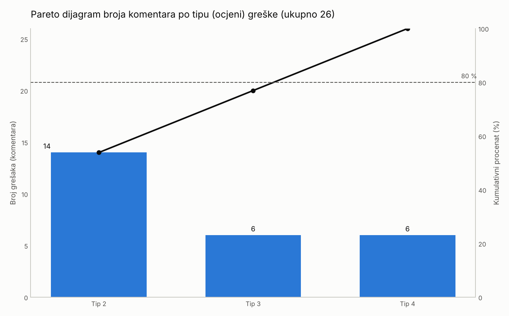
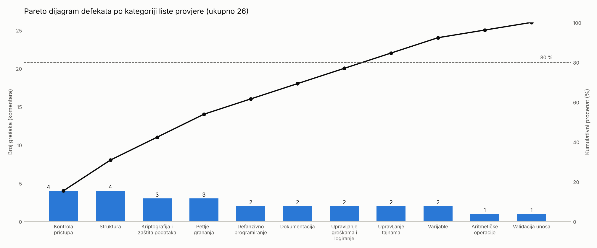
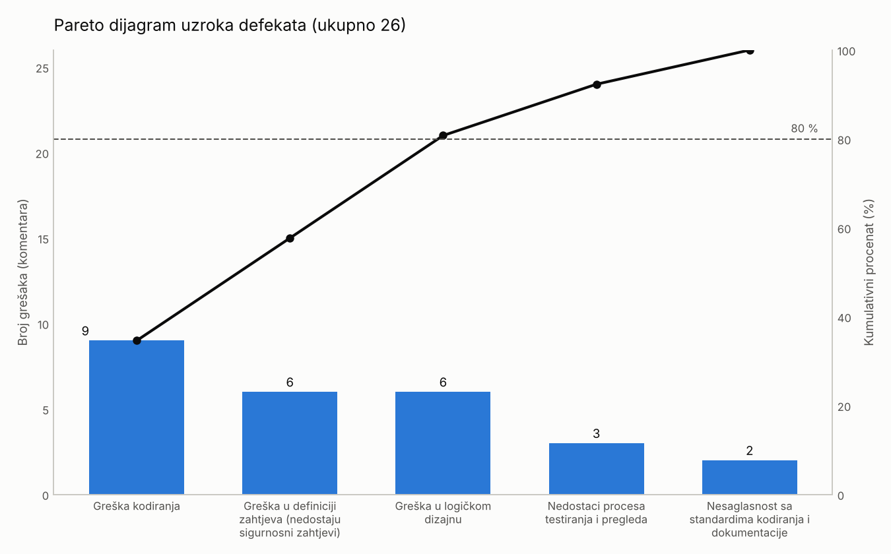
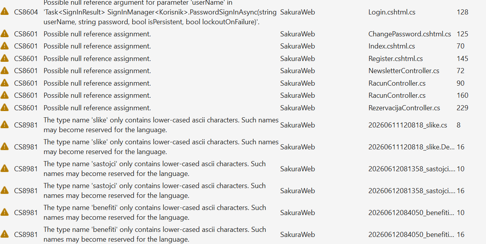
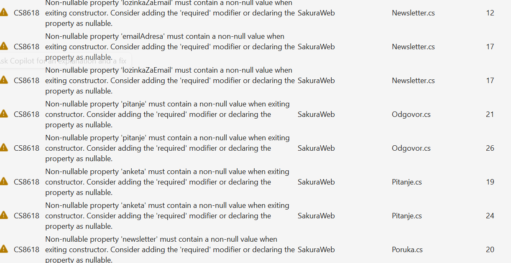
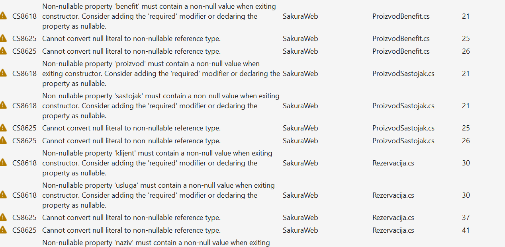
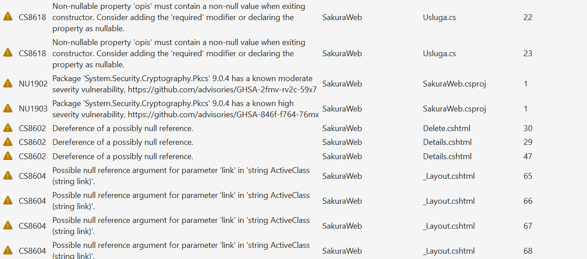

# Izvještaj – Task 1: Inspekcija koda i statička analiza

**Predmet:** Verifikacija i validacija softvera, projektni zadatak – I dio
**Tim:** Grupa 5 – Tim 3 (Ilma, Amna, Amina, Dževad, Hana)
**Preuzeti projekat:** SakuraWeb, tim ooad-2025-26/Grupa1-Tim4
**Grana sa kodom:** `Inspekcija` · **Pull request:** `Inspekcija` → `main`

## 1. Rad i raspored u timu

| Uloga | Član | Analizirani kod | Komentara | Issue |
|---|---|---|---:|---|
| Moderator | Ilma | `UslugaController`, `Services/EmailSender.cs`, `Data/`, modeli, `appsettings.json` | 6 | |
| Inspektor | Amna | `RezervacijaController` | 5 | N01 |
| Inspektor | Amina | `ProizvodiController`, `Models/Proizvod.cs` | 5 | |
| Inspektor | Dževad | `RacunController`, `Models/Korisnik.cs` | 5 | |
| Inspektor | Hana | `AnketaController`, `NewsletterController`, `Models/Newsletter.cs` | 5 | N37 |

Moderator je preuzeo kod na granu `Inspekcija`, otvorio pull request prema grani `main`, podijelio dijelove koda i liste provjere te sastavio ovaj izvještaj. `Program.cs` i pogledi (`Views`) nisu analizirani.

Svaki član je svoj dio pregledao u dva prolaza:

1. sa opštom listom *Generic Checklist for Code Reviews* (Wiegers),
2. sa sigurnosnom listom provjere iz Predavanja 3 (validacija unosa, tajne, kontrola pristupa, kriptografija, greške i logiranje, vanjske komponente).

Svaki komentar u pull requestu ima tri dijela, kako traže upute: opis, tip greške (1–5 prema dokumentu „Greške opisi“) i stavku liste provjere. Tokom pripreme evidentirano je više kandidata. Tim je objavio samo nalaze koje su svi potvrdili, pa oznake (N01–N61) nisu uzastopne. Za dvije najteže greške otvorene su issue kartice: N01 i N37.

## 2. Rezultati inspekcije

| Stavka | Vrijednost |
|---|---|
| Pregledano linija koda (bez `Program.cs`, `Views`, migracija) | oko 2.380 |
| Objavljeno komentara (grešaka) | 26 |
| Po opštoj listi provjere | 14 |
| Po sigurnosnoj listi provjere | 12 |
| Gustoća grešaka | oko 11 na 1.000 linija |
| Issue kartice | 2 (N01, N37) |

Grešaka tipa 1 i tipa 5 nema: aplikacija se pokreće i osnovne funkcije rade, a kod je uredno formatiran jer je većim dijelom generisan alatom za scaffolding.

Skala iz dokumenta „Greške opisi“ nema posebnu stavku za sigurnosne propuste. Svrstali smo ih u tip 2 („funkcioniše, ali pogrešno“), jer aplikacija radi, ali dozvoljava ono što ne bi smjela. Najvažnije su:

- **N01:** `RezervacijaController.DeleteConfirmed` nema `[Authorize]`, pa rezervaciju može obrisati i neprijavljen korisnik.
- **N16 i N37:** `ProizvodiController` i `AnketaController` uopšte nemaju autorizaciju, pa bilo ko može dodavati, mijenjati i brisati proizvode i ankete.
- **N27, N29, N44, N45:** lozinke se šalju e-mailom, čuvaju u čistom tekstu ili ispisuju na konzolu.

## 3. Pareto analiza

### 3.1 Broj komentara po tipu (ocjeni) greške

| Tip greške | Broj | Udio | Kumulativno |
|---|---:|---:|---:|
| tip 2 – Ozbiljna greška | 14 | 53.8 % | 53.8 % |
| tip 3 – Umjerena greška | 6 | 23.1 % | 76.9 % |
| tip 4 – Mala greška | 6 | 23.1 % | 100.0 % |

Više od polovine komentara (14 od 26) su greške tipa 2, a tipovi 2 i 3 zajedno čine 77 %. Od 14 grešaka tipa 2, njih 10 je pronađeno sigurnosnom listom provjere.

Zaključak: najveći rizik u ovom kodu nije stil pisanja, nego nedostatak provjera ko šta smije raditi i loše rukovanje lozinkama.

### 3.2 Greške po kategoriji liste provjere

| Kategorija defekta | Broj | Udio | Kumulativno |
|---|---:|---:|---:|
| Kontrola pristupa | 4 | 15.4 % | 15.4 % |
| Struktura | 4 | 15.4 % | 30.8 % |
| Kriptografija i zaštita podataka | 3 | 11.5 % | 42.3 % |
| Petlje i grananja | 3 | 11.5 % | 53.8 % |
| Defanzivno programiranje | 2 | 7.7 % | 61.5 % |
| Dokumentacija | 2 | 7.7 % | 69.2 % |
| Upravljanje greškama i logiranje | 2 | 7.7 % | 76.9 % |
| Upravljanje tajnama | 2 | 7.7 % | 84.6 % |
| Varijable | 2 | 7.7 % | 92.3 % |
| Aritmetičke operacije | 1 | 3.8 % | 96.2 % |
| Validacija unosa | 1 | 3.8 % | 100.0 % |

Greške su raspoređene na 11 kategorija, pa granica od 80 % zahtijeva osam kategorija. Pravilo 80/20 se po kategorijama ne vidi jasno, jer je svaki član pregledao drugačiji dio koda.

Na vrhu su kontrola pristupa i struktura (po 4 greške), ali se jako razlikuju po težini: sve četiri greške kontrole pristupa su tipa 2, a od četiri strukturne samo jedna.

### 3.3 Uzroci grešaka

| Uzrok | Broj | Udio | Kumulativno |
|---|---:|---:|---:|
| Greška kodiranja | 9 | 34.6 % | 34.6 % |
| Greška u definiciji zahtjeva (nedostaju sigurnosni zahtjevi) | 6 | 23.1 % | 57.7 % |
| Greška u logičkom dizajnu | 6 | 23.1 % | 80.8 % |
| Nedostaci procesa testiranja i pregleda | 3 | 11.5 % | 92.3 % |
| Nesaglasnost sa standardima kodiranja i dokumentacije | 2 | 7.7 % | 100.0 % |

Uzroci su klasifikovani prema Predavanju 1 (poglavlje 1.4). Tri uzroka čine 81 % grešaka: greške kodiranja (9), greške u logičkom dizajnu (6) i nedostatak sigurnosnih zahtjeva (6).

Greške kodiranja su najbrojnije, ali su samo 2 od njih tipa 2. Logički dizajn i nedostajući sigurnosni zahtjevi daju 11 od 14 grešaka tipa 2. Autorizacija očigledno nije bila propisana po akcijama: `RacunController` i `UslugaController` je imaju, a `ProizvodiController` i `AnketaController` nemaju. Najveći dobitak bi dala jasna lista zahtjeva o tome koja uloga smije koju akciju, a ne pažljivije kodiranje.

### 3.4 Preporuke autorima

1. Dodati `[Authorize]` na sve akcije koje mijenjaju podatke i provjeru vlasništva nad rezervacijom (N01, N02, N16, N37).
2. Ukloniti polje `lozinka` iz modela, ne slati lozinku e-mailom, obrisati ispis lozinke na konzolu, a lozinku e-mail naloga i konekcijski string čuvati van repozitorija (N27, N29, N44, N45, N61).
3. Provjeru zauzetosti termina vezati za frizera i ponoviti je pri izmjeni rezervacije (N04, N06).
4. Ažurirati paket `System.Security.Cryptography.Pkcs` na verziju bez poznatih ranjivosti (nalaz statičke analize, poglavlje 4).

## 4. Statička analiza koda

**Alat:** Visual Studio 2022, prozor *Error List* nakon *Rebuild Solution*: Roslyn analizatori kompajlera (oznake `CS`) i NuGet provjera ranjivih paketa (oznake `NU`). Snimci ekrana su u folderu `slike/`, a sva upozorenja sa ocjenom u fajlu `staticka_analiza.csv`.

### 4.1 Rezultati alata

Na snimcima je 44 upozorenja. Grešaka koje sprečavaju kompajliranje nema. Iz analize su isključena:

- 7 upozorenja u pogledima (`Views`): CS8602 i CS8604 u `.cshtml` fajlovima;
- 6 upozorenja u migracijama: CS8981, nazivi klasa malim slovima. Taj kod generiše EF Core.

Ostaje **31 upozorenje u opsegu inspekcije**:

| Pravilo | Značenje | Broj | Gdje |
|---|---|---:|---|
| CS8618 | Svojstvo koje ne smije biti `null` nije inicijalizirano u konstruktoru | 15 | `Newsletter`, `Odgovor`, `Pitanje`, `Poruka`, `ProizvodBenefit`, `ProizvodSastojak`, `Rezervacija`, `Usluga` |
| CS8601 | Moguća dodjela `null` vrijednosti | 7 | `RacunController` (2), `NewsletterController`, `RezervacijaController`, Identity stranice (3) |
| CS8625 | Literal `null` dodijeljen tipu koji ne smije biti `null` | 6 | `ProizvodBenefit`, `ProizvodSastojak`, `Rezervacija` |
| CS8604 | Mogući `null` argument | 1 | Identity stranica `Login` |
| NU1902 | Paket sa poznatom ranjivošću umjerene težine | 1 | `System.Security.Cryptography.Pkcs` 9.0.4 |
| NU1903 | Paket sa poznatom ranjivošću visoke težine | 1 | `System.Security.Cryptography.Pkcs` 9.0.4 |

Svako upozorenje smo provjerili u kodu:

| Ocjena | Broj | Objašnjenje |
|---|---:|---|
| Stvaran problem | 14 | Objekat može nastati sa `null` vrijednostima (CS8618 u `Newsletter` i `Usluga`, svih 6 CS8625), `FindAsync(1)` može vratiti `null` (`NewsletterController` 72), ranjiv paket (NU1902, NU1903) |
| U praksi lažno pozitivno | 13 | 10 × CS8618 nad navigacijskim svojstvima koja EF Core popunjava pri učitavanju; `RacunController` 90 i 160 (`PasswordHash` nakon uspješnog `CreateAsync` nije `null`); `RezervacijaController` 229 (akcija je dostupna samo prijavljenom klijentu, pa ID korisnika postoji) |
| Generisan kod | 4 | Identity stranice (`Login`, `ChangePassword`, `Index`, `Register`) koje generiše ASP.NET Core Identity |

Oko 42 % upozorenja u opsegu (13 od 31) ne predstavlja grešku pri izvršavanju. To je u skladu sa Predavanjem 2: statička analiza daje lažno pozitivne nalaze, pa svako upozorenje treba pregledati čovjek.

### 4.2 Poređenje sa ručnom inspekcijom

| Nalaz | Ručna inspekcija | Statička analiza |
|---|---|---|
| N52 – neinicijalizirana svojstva i dodjela `null` u modelima | Da | **Da**, ista mjesta (CS8618, CS8625), i još 8 sličnih mjesta koja inspekcija nije navela |
| N29 – polje `lozinka` duplira hash i čuva lozinku | Da | Djelimično: alat označava baš linije 90 i 160 (`lozinka = PasswordHash`), ali samo zbog moguće `null` vrijednosti, ne kao sigurnosni problem |
| N45 – lozinka e-mail naloga u bazi u čistom tekstu | Da | Djelimično: alat označava svojstvo `lozinkaZaEmail`, ali samo kao neinicijalizirano |
| N46 – Newsletter `Create` bez provjere modela i sa fiksnim ID-em | Da | Djelimično: alat označava liniju 72 (`FindAsync(1)` može vratiti `null`) |
| Ranjiv paket `System.Security.Cryptography.Pkcs` 9.0.4 | **Ne** | **Da** (NU1902, NU1903) |
| N01, N02, N16, N37 – nedostaje autorizacija | Da | Ne |
| N04, N06 – logika zauzetosti termina | Da | Ne |
| N27, N44, N61 – lozinke u e-mailu i konzoli, konekcijski string u repozitoriju | Da | Ne |
| N30, N50, N51 – neobrađen izuzetak, kaskadno brisanje, izlaganje podataka korisnika | Da | Ne |
| N08, N19, N24, N25, N26, N32, N34, N40, N56, N58 – magični brojevi, poređenje enuma sa stringom, zakomentarisan kod, nekorištene direktive i varijable, `double` za cijenu, duplirana polja, dupli atribut, SMTP u kodu, nekorištena klasa | Da | Ne (pravila za ovo postoje, npr. IDE0005 i CA2000, ali nisu uključena u standardnom nivou upozorenja) |

Od 26 grešaka ručne inspekcije, alat je potpuno pronašao jednu (N52), a na tri je ukazao na pravo mjesto zbog drugog razloga (N29, N45, N46). Preostale 22 nije prijavio.

### 4.3 Komentar

Statička analiza i ručna inspekcija pronalaze različite vrste grešaka. Alat je brz, ništa ne preskače i tačno je našao sva mjesta gdje modeli dozvoljavaju `null` vrijednosti, uključujući osam koje mi nismo naveli. Jedini je pronašao ranjivu verziju paketa `System.Security.Cryptography.Pkcs`. Taj paket se ne vidi u `SakuraWeb.csproj` jer dolazi posredno, kao zavisnost drugog paketa, pa ga čitanjem koda nije bilo moguće uočiti.

S druge strane, alat nije prijavio nijednu od 14 grešaka tipa 2 osim kao usputnu napomenu o `null` vrijednosti. Nije prijavio nedostajuću autorizaciju, pogrešnu logiku rezervacija ni lozinke u čistom tekstu. Za te greške treba znati šta aplikacija treba da radi i ko smije šta, a to alat ne zna. Na linijama 90 i 160 u `RacunController` alat je bio na pravom mjestu, ali je problem pogrešno opisao: upozorio je na `null`, a stvarni problem je čuvanje lozinke.

Oko 42 % upozorenja je u praksi lažno pozitivno, najčešće zbog navigacijskih svojstava koja popunjava EF Core. Bez ručne provjere tim bi trošio vrijeme na ispravke koje ništa ne mijenjaju.

Zaključak se poklapa sa Predavanjem 2: alate za statičku analizu treba pokrenuti prije formalnog pregleda, da se mehaničke greške uklone automatski, a vrijeme inspekcije iskoristi za logiku, zahtjeve i sigurnost.

## 5. Lista svih komentara

Potpuni tekst svakog komentara je u fajlu [Nalazi_inspekcije.md](Nalazi_inspekcije.md), a tabela za obradu u `nalazi.csv`.

| ID | Fajl | Linije | Kategorija | Tip | Inspektor | Issue |
|---|---|---|---|:-:|---|:-:|
| N01 | `Controllers/RezervacijaController.cs` | 339-351 | Kontrola pristupa | 2 | Amna | ✔ |
| N02 | `Controllers/RezervacijaController.cs` | 125-144 | Kontrola pristupa | 2 | Amna |  |
| N04 | `Controllers/RezervacijaController.cs` | 199-204 | Petlje i grananja | 2 | Amna |  |
| N06 | `Controllers/RezervacijaController.cs` | 285-314 | Petlje i grananja | 2 | Amna |  |
| N08 | `Controllers/RezervacijaController.cs` | 179-212, 371-374 | Struktura | 4 | Amna |  |
| N16 | `Controllers/ProizvodiController.cs` | 14-308 | Kontrola pristupa | 2 | Amina |  |
| N19 | `Controllers/ProizvodiController.cs` | 30 | Petlje i grananja | 3 | Amina |  |
| N24 | `Controllers/ProizvodiController.cs` | 67, 71, 83-90 | Dokumentacija | 4 | Amina |  |
| N25 | `Controllers/ProizvodiController.cs` | 7 (i using direktive u ostalim kontrolerima) | Struktura | 4 | Amina |  |
| N26 | `Models/Proizvod.cs` | 19 (Models/Usluga.cs 15) | Aritmetičke operacije | 3 | Amina |  |
| N27 | `Controllers/RacunController.cs` | 164-167 | Kriptografija i zaštita podataka | 2 | Dževad |  |
| N29 | `Controllers/RacunController.cs` | 70-91 (Models/Korisnik.cs 10) | Kriptografija i zaštita podataka | 2 | Dževad |  |
| N30 | `Controllers/RacunController.cs` | 240-261 | Upravljanje greškama i logiranje | 2 | Dževad |  |
| N32 | `Controllers/RacunController.cs` | 75-76 (Models/Korisnik.cs 8-9) | Struktura | 2 | Dževad |  |
| N34 | `Controllers/RacunController.cs` | 182 | Varijable | 4 | Dževad |  |
| N37 | `Controllers/AnketaController.cs` | 13-218 | Kontrola pristupa | 2 | Hana | ✔ |
| N40 | `Controllers/AnketaController.cs` | 181-183 | Dokumentacija | 4 | Hana |  |
| N44 | `Controllers/NewsletterController.cs` | 99 | Upravljanje greškama i logiranje | 2 | Hana |  |
| N45 | `Models/Newsletter.cs` | 10 (NewsletterController 146) | Upravljanje tajnama | 2 | Hana |  |
| N46 | `Controllers/NewsletterController.cs` | 69-79 | Validacija unosa | 2 | Hana |  |
| N50 | `Controllers/UslugaController.cs` | 162-172 | Defanzivno programiranje | 2 | Ilma |  |
| N51 | `Controllers/UslugaController.cs` | 36-38 | Kriptografija i zaštita podataka | 3 | Ilma |  |
| N52 | `Models/Usluga.cs` | 11-12 (Rezervacija.cs 37, 41; ProizvodBenefit.cs 25-26) | Varijable | 3 | Ilma |  |
| N56 | `Services/EmailSender.cs` | 53-66 | Defanzivno programiranje | 3 | Ilma |  |
| N58 | `Data/ApplicationUser.cs` | 1-6 | Struktura | 4 | Ilma |  |
| N61 | `appsettings.json` | 3 | Upravljanje tajnama | 3 | Ilma |  |
